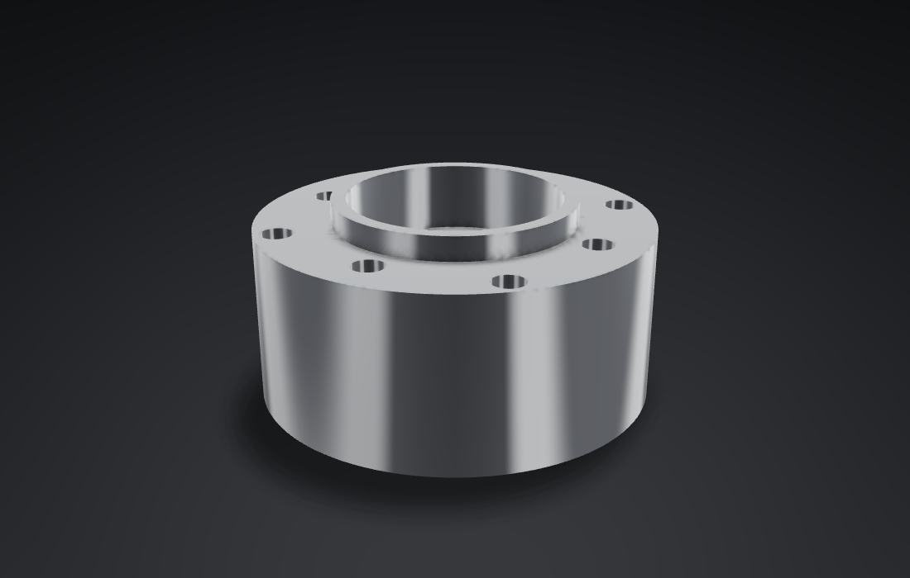

# Studio: polished metal under studio lights

A sixth style, after a product shot the user shared (branch `p8-studio-style`, 2026-11-08,
9 PM–10:10 PM Pacific Time). See ADR 0009's addendum for the decisions.

## Tuning against the reference

The reference is a polished stainless bracket on a charcoal sweep. Its tones, on a 0–255 scale:

| Surface | Reference |
|---|---|
| Faces turned to the camera | 45–85, lighter lower down |
| Tops | about 155 |
| Fillets and curved edges | 200–240 |
| Backdrop, top to bottom | 4–18 to about 50 |

- **The first try, Metal's studio on a dark sheet,** drew tops near white and every face light: a
  satin studio is bright everywhere.
- **Flat faces mirror one direction each.** At the usual three-quarter view that direction is one
  of the studio's two tall strip lights, about 40° either side of the view, so a polished flat face
  turned to the camera came out nearly white. Studio keeps the strips faint and lights curves with
  the key box and the horizon band, which a curved face sweeps through.
- **The room is dark:** floor and side walls at about a tenth of Metal's, so faces turned to the
  camera mirror darkness, and an overhead sky of 0.55 for the tops. Metals keep 6% diffuse light
  (Metal's 40%) and half Metal's roughness, never below 0.15.
- **The GP52C flange now reads:** faces turned to the camera about 60, its top about 130, the bores
  and the outer cylinder swept by bright bands, a soft black shadow below.
- **Flat-faced parts are plainer than the reference.** A flat face takes one tone, where the
  reference's has the falloff of a near area light. The studio is a light at infinity, as Metal's
  is; a near light would need more than a new row of values.

## GPU time

`geometry-webgpu bench` at 2880×1800 on the M4 Max, Metal's offscreen frames over 2048 frames of an
orbit and Dawn's over 300, in alternating runs. Median frame, ms; 90th percentile in brackets.

| Fixture | Metal renderer: Metal | Studio | Dawn (WebGPU): Metal | Studio |
|---|---|---|---|---|
| 13S4P pack, 837 parts | 1.78 (1.86) | **1.13** (1.21) | 1.55 (1.58–1.67) | **1.12–1.15** (1.30–1.40) |
| Rack of 100k parts | 4.36 (5.00) | **2.72** (2.80–2.84) | 3.97–3.98 (4.03) | **2.04** (2.14) |
| 10M-triangle STL | 6.75–7.61 (8.6–9.0) | **2.92** (3.06–3.14) | 7.08–7.32 (7.43–7.70) | **4.80–4.81** (5.57–5.66) |

- **Studio costs a third to three fifths of Metal's frame.** No crease pass runs while nothing is
  selected or hovered, and the composite has no outline search. The rack's Studio frame on Dawn,
  2.04 ms, is the no-edges frame measured in P7 (1.95 ms).
- **While a part is hovered or selected, its edges are drawn** to highlight it: only that part's,
  culled per occurrence. For a single mesh of 10M triangles that is every edge, as in the other
  styles, for as long as it is hovered.
- Raw lines: `studio-bench.txt`.

## Checks

- The 14 existing goldens are pixel for pixel what they were. Studio has four of its own.
- The WebGPU-vs-Metal matrix draws Studio in every colour mode, with selection and hover, whose
  highlights show and nothing else does, and with ghosts as dashed lines.
- The Mac app: the picker takes six styles and the masthead turns light on Studio's sheet.
- All suites: release, debug, ASan, TSan, wasm-release, wasm-threads, Dawn, the launcher (which
  now offers `studio` to AI apps) and Chrome end to end.
