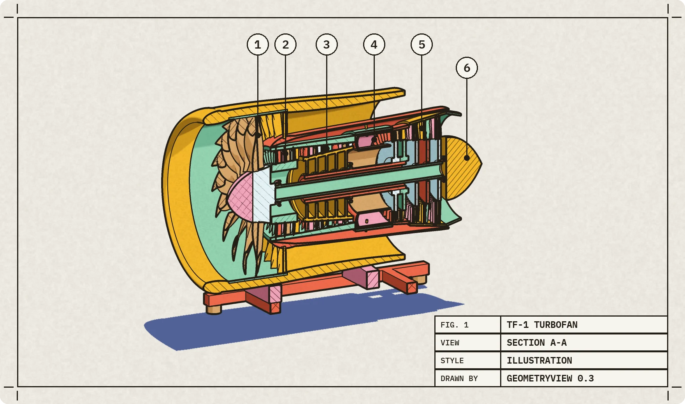
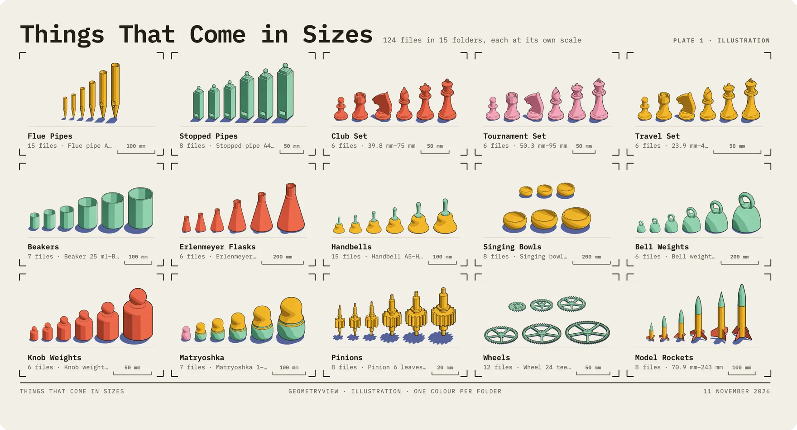

# GeometryView

**See inside your CAD models, and a whole folder of them at once.** STEP and STL, in your browser,
on a Mac, on your phone, and from your AI apps.



## View a model

```sh
npx geometryview part.step     # opens it in your browser
npx geometryview               # the viewer, with your folders and recent files
```

The viewer is served from your computer only (127.0.0.1), and your files never leave it. It needs a
browser with WebGPU: Chrome or Edge, or Safari 26 or later; on Linux it opens a Chrome window of its
own, with Vulkan on. Or use the hosted copy:
[atharvaaalok.github.io/geometryview](https://atharvaaalok.github.io/geometryview/).

Connect a folder and every part in it is drawn to scale, five ways: Plates, Sheet, Ladders, Atlas and
Catalogue.



## Use it from your AI app

```sh
claude mcp add geometryview -- npx -y geometryview --mcp     # Claude Code
codex mcp add geometryview -- npx -y geometryview --mcp      # Codex
```

Other apps take the same command, `npx -y geometryview --mcp`, in their MCP settings. Claude Desktop
installs it in one click from the `.mcpb` in the
[latest release](https://github.com/atharvaaalok/geometryview/releases/latest).

- `open_model` opens a file and sums it up.
- `get_structure` lists its assemblies and parts.
- `render_view` returns a picture: any view, any of six styles, sections, parts alone.
- `open_in_viewer` shows it to you, live.
- `view_folder` pictures a whole folder on one contact sheet. It needs the native engine: the Claude
  Desktop extension for Mac, or a build from source.

Your files stay on your computer. The pictures, part names and structure the tools return go to
your AI app, and from it to its provider.

More, including the Mac app and the iPhone:
[github.com/atharvaaalok/geometryview](https://github.com/atharvaaalok/geometryview). MIT licensed.
