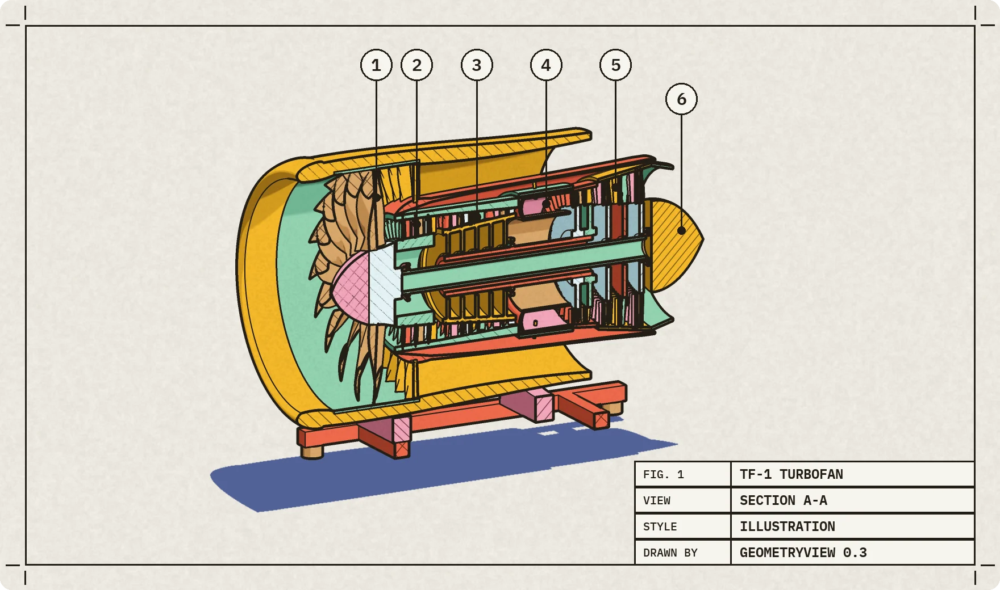
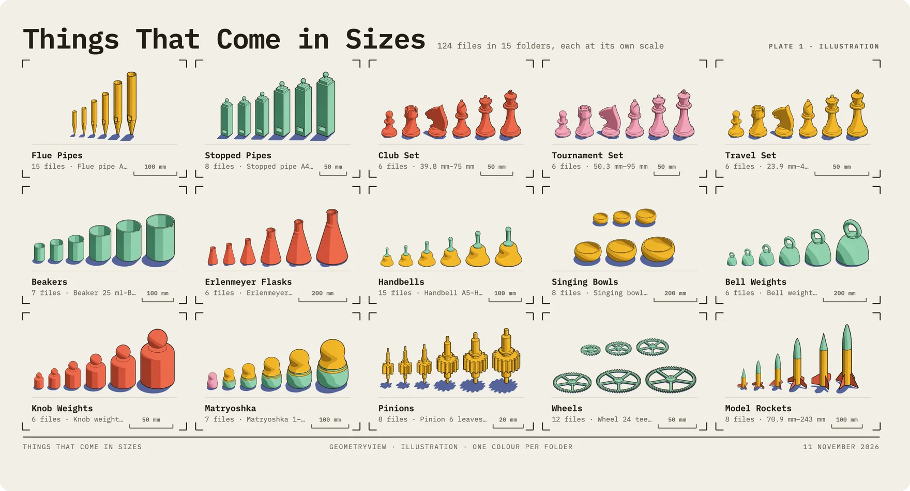
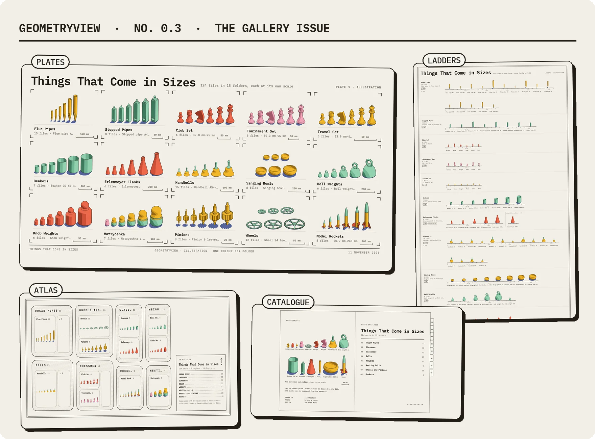
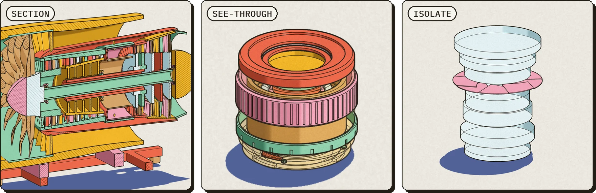
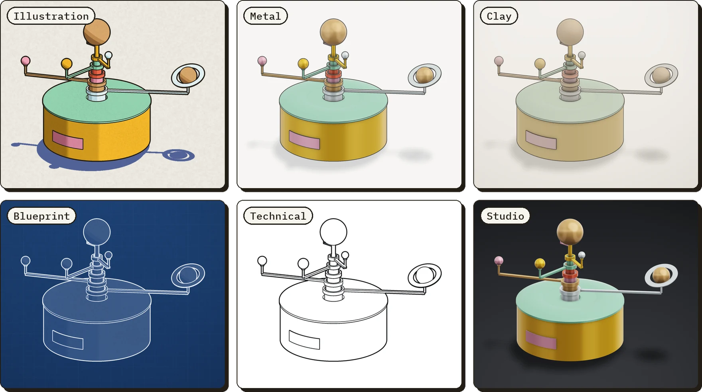
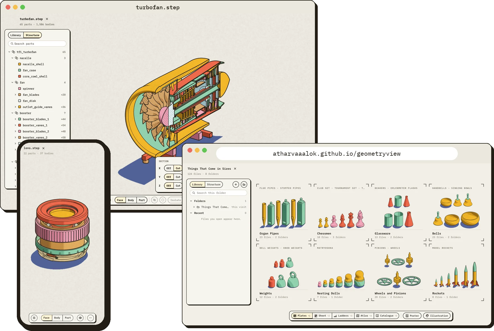
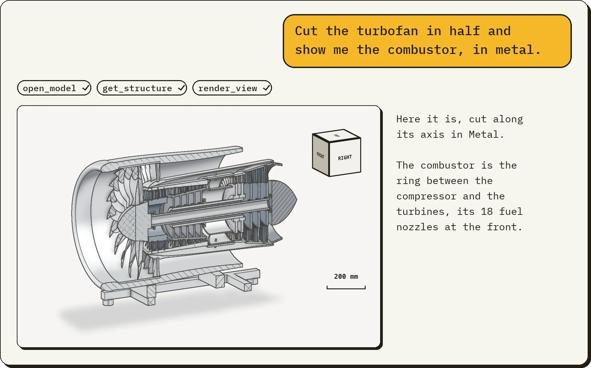

<h1 align="center">GeometryView</h1>

<p align="center">
  <b>See inside your CAD models, and a whole folder of them at once.</b><br>
  STEP and STL, drawn like the plates of a technical manual: in your browser,<br>
  on a Mac, on your phone, and from your AI apps.
</p>

<p align="center">
  <picture>
    <source media="(prefers-color-scheme: dark)" srcset="Docs/media/fig1-dark.webp">
    
  </picture>
</p>

<p align="center"><sub><b>FIG. 1</b> · TF-1 turbofan, section A–A. 1 Fan · 2 Booster · 3 HP compressor · 4 Combustor · 5 Turbines · 6 Exhaust</sub></p>

<p align="center">
  <a href="https://atharvaaalok.github.io/geometryview/"><b>Open it in your browser</b></a> ·
  <a href="#use-it-from-your-ai-app"><b>Add it to your AI app</b></a> ·
  <a href="#mac-app"><b>Get the Mac app</b></a>
</p>

## Get it

| | |
|---|---|
| **In your browser** | **[Open GeometryView](https://atharvaaalok.github.io/geometryview/)** in Chrome or Edge on Windows or a Mac, or in Safari 26 or later. The page has no server behind it: the files you open stay on your computer. |
| **From a terminal** | `npx geometryview part.step` serves the viewer from your computer and opens the file in it. Node 20 or later. On Linux it opens a Chrome window of its own, with the Vulkan that WebGPU needs there. |
| **On a Mac** | [GeometryView for Mac](https://github.com/atharvaaalok/geometryview/releases/latest/download/GeometryView-mac.zip): macOS 26 or later, Apple silicon. Signed and notarized. |
| **On iPhone and iPad** | Open the site in Safari, then Share ▸ Add to Home Screen. iOS 26 or later. |
| **In your AI app** | `claude mcp add geometryview -- npx -y geometryview --mcp`, or [Codex, Claude Desktop, VS Code, Cursor and others](#use-it-from-your-ai-app). |

## A whole folder at a glance

Connect a folder and click it in the Library: every part in it is drawn to scale, in the look you
chose. This one is *Things That Come in Sizes*: 124 parts in 15 families, from organ pipes and
chess sets to clock wheels and model rockets, each family a real size series.

<p align="center">
  <picture>
    <source media="(prefers-color-scheme: dark)" srcset="Docs/media/plates-dark.webp">
    
  </picture>
</p>

[Download the folder](https://github.com/atharvaaalok/geometryview/releases/latest/download/things-that-come-in-sizes.zip)
and open it to try.

## Five ways to look at a folder

<p align="center">
  <picture>
    <source media="(prefers-color-scheme: dark)" srcset="Docs/media/wall-dark.webp">
    
  </picture>
</p>

- **Plates** (⌘1 on a Mac, ⌥1 in a browser): each folder a plate of its parts standing at one
  scale, with its sizes and counts.
- **Sheet** (⌘2, ⌥2): every file on a contact sheet, fitted, to each folder's scale or all to one,
  by size or by name.
- **Ladders** (⌘3, ⌥3): each family on a ruler, smallest to largest, at a drafting scale (1:2,
  1:10…).
- **Atlas** (⌘4, ⌥4): the folder as a map. Its folders are regions, and zooming in names every
  part.
- **Catalogue** (⌘5, ⌥5): the folder typeset as a printed parts catalogue, with contents, a plate
  and a table of measured sizes for each folder, and an index.

Type to search any view: "C5" finds a flue pipe, a stopped pipe and a handbell. Space opens
**Peek**, the part large with its size, parts and triangles; drag across it to turn it. **Show as
Poster** prints any view on one sheet, as PNG or PDF, and a Catalogue's PDF is the whole book.

## Inside the model

<p align="center">
  <picture>
    <source media="(prefers-color-scheme: dark)" srcset="Docs/media/inside-dark.webp">
    
  </picture>
</p>

**Section** (S) slides cuts along X, Y and Z, with hatched caps where they cut. **See-through** (T)
turns housings to glass and leaves the mechanism solid. **Isolate** (I) shows the selection alone,
as if nothing else were open. Hold H and click to hide what you click, peeling layers; hold G to
ghost it.

## Six looks, one click apart

<p align="center">
  <picture>
    <source media="(prefers-color-scheme: dark)" srcset="Docs/media/styles-dark.webp">
    
  </picture>
</p>

Colour parts by their material (read from their names), one colour per part, one colour
throughout, or the file's own colours. Add a cast shadow, paper grain or a hand-drawn wobble.

## One viewer, everywhere

<p align="center">
  <picture>
    <source media="(prefers-color-scheme: dark)" srcset="Docs/media/everywhere-dark.webp">
    
  </picture>
</p>

The Mac app draws with Metal; browsers and phones with WebGPU, from the same C++ engine. All of
them have the same looks, controls, gallery and Library: connect a folder to browse every model in
it, and reopen recent files at once. In Chrome and Edge a connected folder is remembered from one
visit to the next.

## Fast, measured

| Opening… | Mac app | Chrome |
|---|---|---|
| the Parade: 100,000 chessmen, 51 MB STEP | 0.1 s | 0.4 s |
| the TF-1 turbofan: 65 parts and 1,586 bodies, 40 MB STEP | 0.4 s | 0.9 s |
| a 10-million-triangle STL: 500 MB | 1.3 s | 2.6 s |

On an M4 Max, each the middle of three runs. The Mac app's times are its import; Chrome's run from
the file read into memory to its last part in. Big STEP files appear while they import, and parts
you zoom into are meshed again more finely once the view settles.

## Use it from your AI app

<p align="center">
  <picture>
    <source media="(prefers-color-scheme: dark)" srcset="Docs/media/chat-dark.webp">
    
  </picture>
</p>

GeometryView gives AI apps five tools: **open_model**, **get_structure**, **render_view** (any
view, style, section or part alone), **open_in_viewer**, which shows you the model live, and
**view_folder**, a whole folder on one contact sheet with an index.

```sh
claude mcp add geometryview -- npx -y geometryview --mcp     # Claude Code
codex mcp add geometryview -- npx -y geometryview --mcp      # Codex
```

**Claude Desktop:** download the extension from the
[latest release](https://github.com/atharvaaalok/geometryview/releases/latest) and double-click it:
`geometryview-mac.mcpb` on a Mac, `geometryview.mcpb` anywhere else. You need
[Node.js](https://nodejs.org) 20 or later for the commands above.

<details>
<summary><b>VS Code, Cursor, Gemini CLI, Windsurf and others</b></summary>

For VS Code:

```sh
code --add-mcp '{"name":"geometryview","type":"stdio","command":"npx","args":["-y","geometryview","--mcp"]}'
```

For the others, add GeometryView to the app's MCP settings: `~/.cursor/mcp.json` for Cursor,
`~/.gemini/settings.json` for Gemini CLI, `~/.codeium/windsurf/mcp_config.json` for Windsurf.

```json
{
  "mcpServers": {
    "geometryview": { "command": "npx", "args": ["-y", "geometryview", "--mcp"] }
  }
}
```

An app started from the Dock may not find `npx`: give its full path (`which npx` prints it).

</details>

The pictures are drawn by the viewer in your browser, which opens when a tool first needs it, so you
see what the AI sees. On a Mac with Apple silicon and macOS 26, `geometryview-mac.mcpb` draws them
with the Mac app's engine instead. `view_folder` needs that engine, so it works there and in a
[build from source](Docs/BUILDING.md), not through `npx`.

Your files stay on your computer, and the tools read them there. What the tools return, the
pictures, part names and structure, goes to your AI app and from it to its provider, like
everything else in the chat.

## Mac app

The native app opens files from Finder and keeps your folders and recent files in its Library. It
draws with Metal 4, and needs macOS 26 or later on Apple silicon.

**[Download GeometryView for Mac](https://github.com/atharvaaalok/geometryview/releases/latest/download/GeometryView-mac.zip)**,
unzip it and move GeometryView to Applications. It's signed and notarized by Apple.

<details>
<summary><b>Build it from source</b></summary>

OCCT, which reads STEP files, takes about five minutes to build the first time. You need Xcode 27
with its Metal Toolchain:

```sh
brew install cmake ninja llvm
git clone https://github.com/atharvaaalok/geometryview && cd geometryview
ThirdParty/build_occt.sh
cmake --preset release && cmake --build --preset release
cmake --build --preset release --target install-app    # puts GeometryView in /Applications
```

</details>

On iPhone and iPad, the site added to your Home Screen opens files from the Files app. A native
shell, which works offline and opens files from the share sheet too, builds from
[`iOS/Shell`](Docs/BUILDING.md#the-iphone-and-ipad-shell).

<details>
<summary><b>Controls</b></summary>

| Input | Action |
|---|---|
| Hover | Highlight the face, body or part under the pointer |
| Click | Select it. Click empty space to clear. Shift or ⌘ adds to the selection |
| 1, 2, 3 | Select faces, bodies or parts |
| Hold H and click | Hide what you click. Repeated clicks peel away layers |
| Hold G and click | Ghost what you click. Click a ghost with G held to bring it back |
| ⇧H | Show everything, hidden and ghosted alike |
| ⇧G | Unghost everything |
| I | Isolate the selection. When everything is shown again, the view returns |
| ⌘Z, ⇧⌘Z | Undo and redo hiding and ghosting |
| Drag | Rotate |
| Scroll, pinch | Zoom toward the pointer |
| Middle drag, or Shift or Space with drag | Pan |
| Right drag | Dolly |
| F | Fit to view |
| P | Switch between orthographic and perspective |
| T | See through the housing |
| S | Cut a section across X; the scissors button opens all three axes |
| ⇧⌘L | The look: style, colours, ghosts, shadow, grain and wobble |
| ⌘1 to ⌘5 (⌥ in a browser) | In a folder: Plates, Sheet, Ladders, Atlas, Catalogue |
| Space | In a folder: Peek, the part large with its size, parts and triangles |
| Click the view cube | Turn to that face's view |
| ⌘O, ⌥⌘O | Open files, connect a folder |
| ⌃⌘S (⌥S in a browser) | Hide or show the sidebar, for the whole window |
| Esc | Close an open card or menu; with none open, clear the selection |
| ? | Show every shortcut |

On a phone, drag with one finger to rotate, pinch to zoom and drag with two fingers to pan. The
Mac app's Settings (⌘,) rebinds every key and what each mouse button drags.

</details>

## How it's built

One C++ engine keeps models in a compact cache, about 12 to 23 bytes a triangle, which the Mac maps
straight from disk. It draws them with mesh shaders on Metal 4, and with WebGPU in browsers. STEP
files are sliced and meshed by [OCCT](https://github.com/Open-Cascade-SAS/OCCT) in parallel
workers, so big assemblies fill in as they import. The priorities, in order: speed, memory,
leanness.

[Docs/PLAN.md](Docs/PLAN.md) is the design, [Docs/adr](Docs/adr) records each decision, and
[Docs/BUILDING.md](Docs/BUILDING.md) covers building every part, testing and releasing. Every
picture on this page is drawn by GeometryView, from models made by
[`Tools/showcase`](Tools/showcase).

## License

[MIT](LICENSE), the showcase models included. GeometryView builds on OCCT, meshoptimizer, xxHash,
IBM Plex Mono and others: see [NOTICES.md](NOTICES.md).
