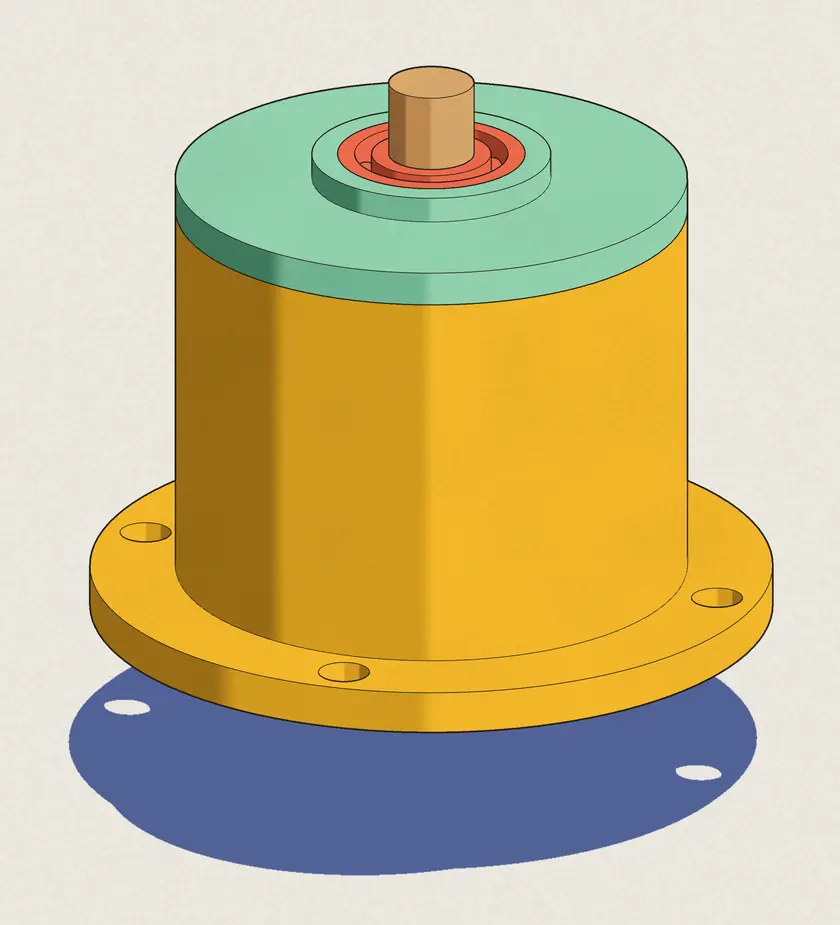
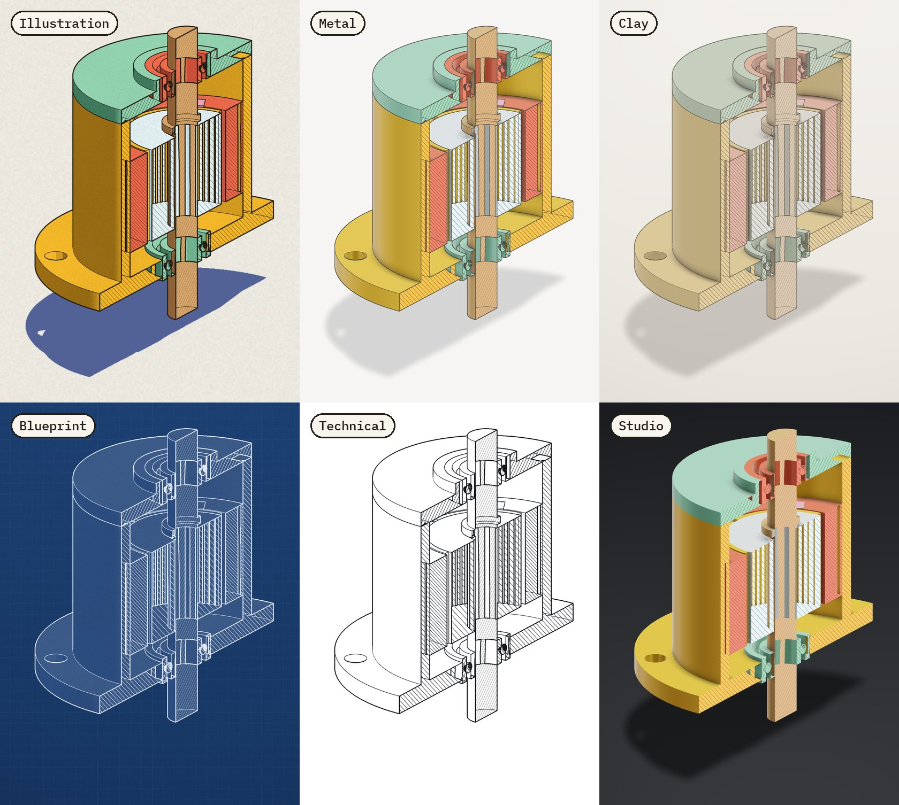
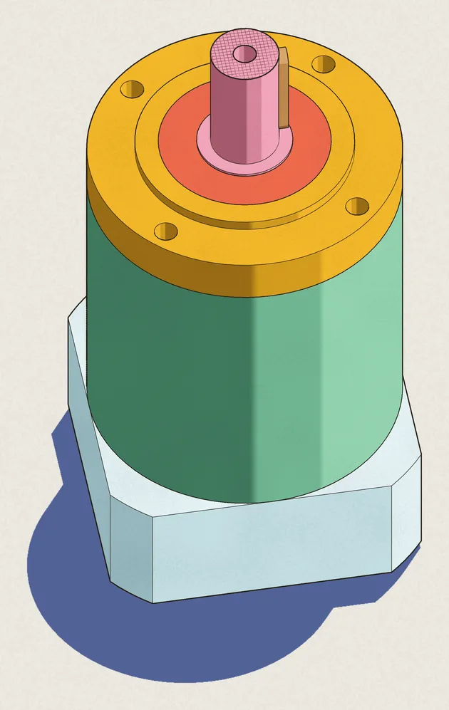
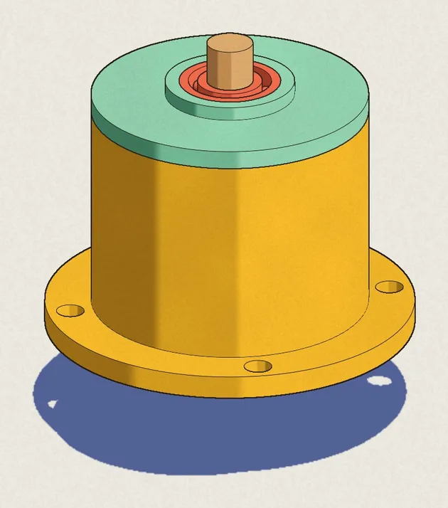
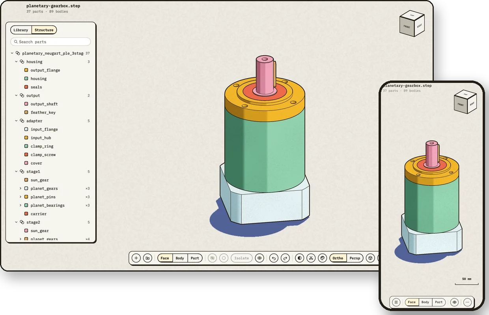
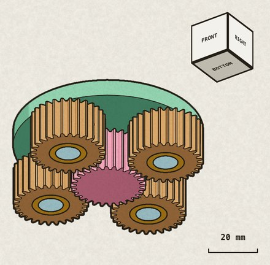
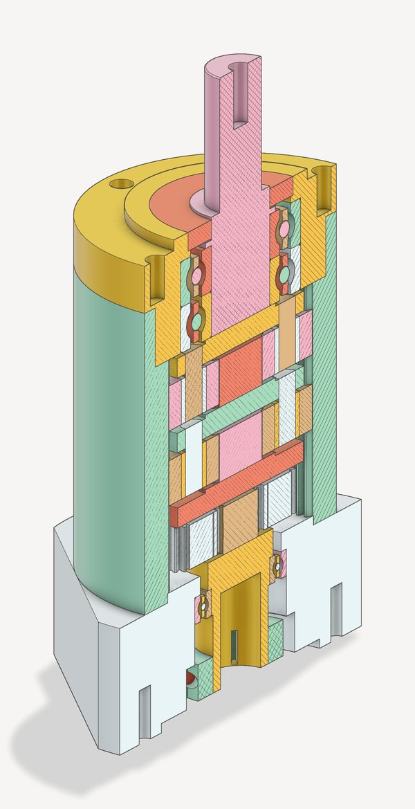
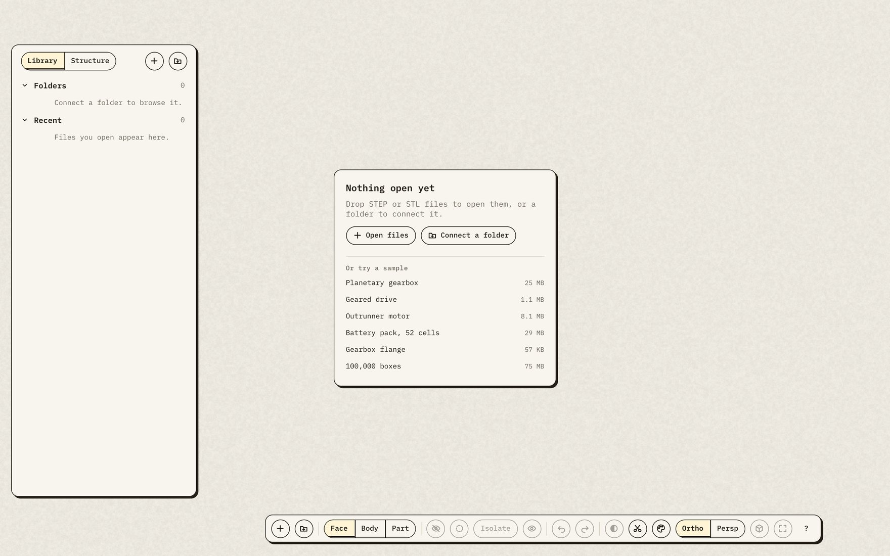

<h1 align="center">GeometryView</h1>

<p align="center">
  <b>See inside your CAD models, fast.</b><br>
  STEP and STL files open in a blink, drawn like the pages of a technical manual:<br>
  on a Mac, in your browser, on your phone, and from your AI apps.
</p>

<p align="center">
  <picture>
    <source media="(prefers-color-scheme: dark)" srcset="Docs/media/hero-dark.webp">
    
  </picture>
</p>

<p align="center">
  <a href="https://atharvaaalok.github.io/geometryview/"><b>Try it in your browser</b></a> ·
  <a href="#use-it-from-your-ai-app"><b>Add it to your AI app</b></a> ·
  <a href="#mac-app"><b>Get the Mac app</b></a>
</p>

- **Fast.** A 100,000-part assembly opens in under a second, in a browser. Big STEP files appear
  while they import.
- **Beautiful.** Six drawing styles, from ink on paper to polished studio metal.
- **Revealing.** Cut sections, see through housings, hide, ghost and isolate parts.
- **Private.** Your files never leave your computer. No account, no upload.

## Six looks, one click apart



Colour parts by their material (read from their names), one colour per part, one colour
throughout, or the file's own colours. Add a cast shadow, paper grain or a hand-drawn wobble.

## Cut it open, see through it

<table>
  <tr>
    <td width="50%"></td>
    <td width="50%"></td>
  </tr>
  <tr>
    <td><b>Section</b> (S): slide cuts along X, Y and Z, with hatched caps where they cut.</td>
    <td><b>See-through</b> (T): the housing turns to glass and the mechanism stays solid. Where nothing is inside anything, as in a row of nuts, every part turns to glass.</td>
  </tr>
</table>

Hold H and click to hide what you click, peeling layers; hold G to ghost it. I isolates the
selection, as if it alone were open.

## A whole folder at a glance

Click a folder in the Library and see every part in it, drawn in the look you chose, to scale, in
five views (⌘1–⌘5 on a Mac, ⌥1–⌥5 in a browser):

- **Plates:** each folder a plate of its parts standing at one scale, with its sizes and counts.
- **Sheet:** every file on a contact sheet, fitted, to each folder's scale or all to one, by size
  or by name.
- **Ladders:** each family on a ruler, smallest to largest, at a drafting scale (1:2, 1:10…).
- **Atlas:** the folder as a map: its folders are regions, and zooming in names every part.
- **Catalogue:** the folder typeset as a printed parts catalogue: contents, a plate and a table of
  measured sizes for each folder, and an index.

Search narrows any view as you type. Space opens Peek: the part large, with its size, parts,
triangles and file; drag across it to turn it. Show as Poster prints any view on one sheet, saved
as PNG or PDF; a Catalogue's PDF is the whole book.

## Fast, measured

| Opening… | Mac app | Chrome |
|---|---|---|
| a planetary gearbox: 25 MB STEP, 37 parts | 0.2 s | 0.7 s |
| a rack of 100,000 parts: 75 MB STEP | 0.1 s | 0.6 s |
| a 10-million-triangle STL: 477 MB | 1.3 s | |

On an M4 Max. The Mac app's times are the import alone; Chrome's run from the click to the last
part drawn, with the file served from the same computer. Parts you zoom into are meshed again more
finely once the view settles.

## One viewer, everywhere



The Mac app draws with Metal; browsers and phones with WebGPU, from the same C++ engine. All of
them have the same looks, controls and Library: connect a folder to browse every model in it, and
reopen recent files at once.

## Use it from your AI app

GeometryView gives AI apps five tools: **open_model**, **get_structure**, **render_view** (any
view, style, section or part alone), **view_folder** (a whole folder on one contact sheet, with an
index) and **open_in_viewer**, which shows you the model live. Ask something like:

> *Open planetary-gearbox.step. Show me the second stage on its own, from below, then cut the
> whole gearbox in half, in metal.*

([Download the gearbox](https://github.com/atharvaaalok/geometryview/releases/latest/download/planetary-gearbox.step)
to try it; the other samples are in the [latest release](https://github.com/atharvaaalok/geometryview/releases/latest).)

The app finds `stage2` with get_structure, and render_view returns:

<table>
  <tr>
    <td></td>
    <td></td>
  </tr>
</table>

**Set it up.** You need [Node.js](https://nodejs.org) 20 or later.

- **Claude Code**

  ```sh
  claude mcp add geometryview -- npx -y geometryview --mcp
  ```

- **Claude Desktop:** download the extension from the
  [latest release](https://github.com/atharvaaalok/geometryview/releases/latest) and double-click
  it: `geometryview-mac.mcpb` on a Mac, `geometryview.mcpb` anywhere else.
- **Codex**

  ```sh
  codex mcp add geometryview -- npx -y geometryview --mcp
  ```

- **VS Code**

  ```sh
  code --add-mcp '{"name":"geometryview","type":"stdio","command":"npx","args":["-y","geometryview","--mcp"]}'
  ```

<details>
<summary><b>Cursor, Gemini CLI, Windsurf and others</b></summary>

Add GeometryView to the app's MCP settings: `~/.cursor/mcp.json` for Cursor,
`~/.gemini/settings.json` for Gemini CLI, `~/.codeium/windsurf/mcp_config.json` for Windsurf.

```json
{
  "mcpServers": {
    "geometryview": { "command": "npx", "args": ["-y", "geometryview", "--mcp"] }
  }
}
```

An app started from the Dock may not find `npx`: give its full path (`which npx` prints it).

</details>

Your AI app's pictures are drawn by the viewer, in your browser, which opens when a tool first
needs it. You see what the AI sees. Claude Desktop's Mac extension draws them itself, with the
Mac app's engine. On a Mac with the [GeometryView app](#mac-app), `open_in_viewer` can show models
in the app instead.

## Browser viewer

<a href="https://atharvaaalok.github.io/geometryview/"></a>

**[atharvaaalok.github.io/geometryview](https://atharvaaalok.github.io/geometryview/)**: drop in
STEP or STL files, connect a folder, or try one of six sample models. The page has no server
behind it, so the files you open never leave your computer.

To run it from your own computer instead, with a file open:

```sh
npx geometryview part.step
```

It needs a browser with WebGPU: Chrome or Edge, or Safari 26 or later. In Chrome and Edge, a
connected folder is remembered from one visit to the next.

## Mac app

The native app opens files from Finder, and keeps your folders and recent files in its Library. It
draws with Metal 4. It needs macOS 26 or later on Apple silicon.

**[Download GeometryView for Mac](https://github.com/atharvaaalok/geometryview/releases/latest/download/GeometryView-mac.zip)**,
unzip it and move GeometryView to Applications. It's signed and notarized by Apple.

<details>
<summary><b>Build it from source</b></summary>

OCCT, which reads STEP files, takes about five minutes to build the first time. You need Xcode 27
with its Metal Toolchain:

```sh
brew install cmake ninja llvm
git clone https://github.com/atharvaaalok/geometryview && cd geometryview
ThirdParty/build_occt.sh
cmake --preset release && cmake --build --preset release
cmake --build --preset release --target install-app    # puts GeometryView in /Applications
```

</details>

## iPhone and iPad

Open **[atharvaaalok.github.io/geometryview](https://atharvaaalok.github.io/geometryview/)** in
Safari, then tap Share ▸ Add to Home Screen. It opens files from the Files app, and needs iOS 26
or later. A native shell, which works offline and opens files from the share sheet too, builds
from [`iOS/Shell`](Docs/BUILDING.md#the-iphone-and-ipad-shell).

<details>
<summary><b>Controls</b></summary>

| Input | Action |
|---|---|
| Hover | Highlight the face, body or part under the pointer |
| Click | Select it. Click empty space to clear. Shift or ⌘ adds to the selection |
| 1, 2, 3 | Select faces, bodies or parts |
| Hold H and click | Hide what you click. Repeated clicks peel away layers |
| Hold G and click | Ghost what you click. Click a ghost with G held to bring it back |
| ⇧H | Show everything, hidden and ghosted alike |
| ⇧G | Unghost everything |
| I | Isolate the selection. When everything is shown again, the view returns |
| ⌘Z, ⇧⌘Z | Undo and redo hiding and ghosting |
| Drag | Rotate |
| Scroll, pinch | Zoom toward the pointer |
| Middle drag, or Shift or Space with drag | Pan |
| Right drag | Dolly |
| F | Fit to view |
| P | Switch between orthographic and perspective |
| T | See through the housing |
| S | Cut a section across X; the scissors button opens all three axes |
| ⇧⌘L | The look: style, colours, ghosts, shadow, grain and wobble |
| Click the view cube | Turn to that face's view |
| ⌘O, ⌥⌘O | Open files, connect a folder |
| Esc | Close an open card or menu; with none open, clear the selection |
| ? | Show every shortcut |

On a phone, drag with one finger to rotate, pinch to zoom and drag with two fingers to pan. The
Mac app's Settings (⌘,) rebinds every key and what each mouse button drags.

</details>

## How it's built

One C++ engine keeps models in a compact cache, about 12 to 23 bytes a triangle, which the Mac maps
straight from disk. It draws them with mesh shaders on Metal 4, and with WebGPU in browsers. STEP files are
sliced and meshed by [OCCT](https://github.com/Open-Cascade-SAS/OCCT) in parallel workers, so big
assemblies fill in as they import. The priorities, in order: speed, memory, leanness.

[Docs/PLAN.md](Docs/PLAN.md) is the design, [Docs/adr](Docs/adr) records each decision, and
[Docs/BUILDING.md](Docs/BUILDING.md) covers building every part, testing and releasing.

## License

[MIT](LICENSE). GeometryView builds on OCCT, meshoptimizer, xxHash, IBM Plex Mono and others: see
[NOTICES.md](NOTICES.md).
